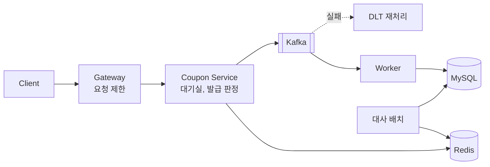

# 선착순 쿠폰 발급 시스템

트래픽이 몰려도 쿠폰을 재고만큼 정확히 발급하고, 빠르게 응답하며, 장애가 나도 발급 기록을 잃지 않도록 단계적으로 개선한 프로젝트입니다.
문제를 재현하고, 해결책을 적용하고, k6로 전후를 측정했습니다.

> 인프런 강의 [트래픽 급증을 견디는 서버 시스템 설계 - Coupon 발급 서비스](https://www.inflearn.com/course/designing-a-server-s)(한조각)를 바탕으로 구현했습니다.

## 브랜치 안내

코드는 단계별 브랜치에 있습니다. 다음 단계는 이전 단계 위에 쌓입니다.

| 주제 | 단계별 브랜치 | 측정 기록 |
|---|---|---|
| 동시성 | [락 없음](https://github.com/mingdy52/coupon/tree/study1/concurrency-1-k6) → [비관적 락](https://github.com/mingdy52/coupon/tree/study1/concurrency-2-pessimistic) → [Redis Lua](https://github.com/mingdy52/coupon/tree/study1/concurrency-3-redis-lua) | [보기](https://github.com/mingdy52/coupon/blob/study5/availability-3-gateway-rate-limit/scripts/load/concurrency/README.md) |
| 응답 속도 | [동기](https://github.com/mingdy52/coupon/tree/study2/latency-1-k6) → [인메모리 큐](https://github.com/mingdy52/coupon/tree/study2/latency-2-inmemory-queue) → [스프링 이벤트](https://github.com/mingdy52/coupon/tree/study2/latency-3-spring-event) → [Kafka](https://github.com/mingdy52/coupon/tree/study2/latency-4-kafka) | [보기](https://github.com/mingdy52/coupon/blob/study5/availability-3-gateway-rate-limit/scripts/load/latency/README.md) |
| 캐시 효율 | [캐시 없음](https://github.com/mingdy52/coupon/tree/study3/efficiency-1-k6) → [Redis 캐시](https://github.com/mingdy52/coupon/tree/study3/efficiency-2-redis-cache) → [Single Flight](https://github.com/mingdy52/coupon/tree/study3/efficiency-3-singleflight) → [SWR](https://github.com/mingdy52/coupon/tree/study3/efficiency-4-swr) → [L1 매진 캐시](https://github.com/mingdy52/coupon/tree/study3/efficiency-5-l1-sold-out) | [보기](https://github.com/mingdy52/coupon/blob/study5/availability-3-gateway-rate-limit/scripts/load/efficiency/README.md) |
| 정합성 | [불일치 주입](https://github.com/mingdy52/coupon/tree/study4/consistency-1-drift-injection) → [DLT 재처리](https://github.com/mingdy52/coupon/tree/study4/consistency-2-dlt-replay) → [대사](https://github.com/mingdy52/coupon/tree/study4/consistency-3-reconcile) | [보기](https://github.com/mingdy52/coupon/blob/study5/availability-3-gateway-rate-limit/scripts/load/consistency/README.md) |
| 가용성 | [기준선](https://github.com/mingdy52/coupon/tree/study5/availability-1-k6) → [가상 대기실](https://github.com/mingdy52/coupon/tree/study5/availability-2-waiting-room) → [Gateway 요청 제한](https://github.com/mingdy52/coupon/tree/study5/availability-3-gateway-rate-limit) | [보기](https://github.com/mingdy52/coupon/blob/study5/availability-3-gateway-rate-limit/scripts/load/availability/README.md) |

## 성과

| 문제 | 해결 | 결과 |
|---|---|---|
| 재고 5,000장에 7,840장 초과 발급 | Redis Lua 원자 연산 | 초과 발급 0건 |
| 3,000 req/s에서 발급 응답 p99 5.93s | Kafka 비동기 저장 | p99 294.71ms, 요청 누락 16,255건 → 0건 |
| 저장 중 서버 강제 종료 | Kafka에 메시지 보관, 멱등 저장 | 미저장 4,859건 재시작 후 전부 복구 |
| DB 커넥션 병목, 처리량 184 req/s | Redis 캐시, Single Flight, SWR | 500 req/s, p99 8.59s → 4.75ms, DB 조회 비율 0.37% |
| 매진 후에도 계속 들어오는 요청 | Caffeine L1 매진 캐시 | 12만 건 모두 앱에서 즉시 거절, Redis 확인은 30회 |
| Redis와 DB 불일치 | DLT 재처리, 대사 배치 | 명단 누락 10건 자동 복구, 저장 실패 10건 감지 |
| 서버를 늘리면 통과 인원도 늘어나는 문제 | 가상 대기실, ShedLock | 서버 2대에서도 초당 약 100명 유지 |
| 한 사용자의 과도한 요청 | Gateway 사용자별 요청 제한 | 어뷰저 200 req/s → 6 req/s, 정상 사용자 제한 0건 |

수치는 앱, DB, Redis, Kafka, k6를 M1 Pro 한 대에서 함께 실행해 측정한 값으로, 단계 간 비교용입니다.
캐시 측정은 무거운 DB 조회를 재현하려고 조회마다 50ms 지연을 넣었습니다.

## 구조



1. Gateway가 사용자별 요청량을 제한합니다.
2. 대기실에서 순번을 받고, 초당 정해진 인원만 입장권을 받습니다.
3. 입장권이 있는 사용자의 재고 차감과 중복 확인을 Redis Lua로 한 번에 처리합니다.
4. Kafka에 발급 요청을 넣고 바로 응답하면, 워커가 DB에 저장합니다.
5. 저장 실패는 DLT로 재처리하고, 대사 배치가 Redis와 DB의 차이를 찾습니다.


## 기술 스택

| 구분 | 사용 기술 |
|---|---|
| Backend | Java 25, Spring Boot 4.1, Spring Data JPA, Spring Cloud Gateway |
| Data | MySQL 8.4, Redis 8.0, Caffeine |
| Messaging | Apache Kafka 3.8 |
| Infra, Test | Docker Compose, Jib, ShedLock, k6 |

## 실행

Docker, JDK 25, jq가 필요합니다.                                                                                                                                                                                         

위 표에서 보고 싶은 브랜치로 이동한 뒤 실행합니다.                                                                                                                                                                         
                                                                                                                                                                                                                             
  ```bash                                                                                                                                                                                                                    
  git switch <branch>                                                                                                                                                                                                        
  ./gradlew --stop && ./gradlew jibDockerBuild && docker compose up -d                                                                                                                                                                                            
```   

`scripts/api.sh`는 쿠폰 생성부터 대기실 통과, 발급, 사용까지 순서대로 호출합니다.

## 남은 과제

앞으로 개인적으로 진행할 과제입니다.

- [ ] (Redis 장애) 재고 유실 시 복구 기준, 장애 중 발급 차단 여부, AOF·Sentinel·Cluster 비교
- [ ] (이중 쓰기) Kafka 발행 실패 처리, 동기 확인·Redis 보상·Transactional Outbox 비교
- [ ] (관측성) Prometheus, Grafana로 커넥션 풀, GC, 컨슈머 lag 확인, 원인 미확인 지연 분석
- [ ] (대기실 운영) 긴 대기열의 폴링 부하 측정(약 10만 명이면 계산상 약 87,000 req/s), 순번별 폴링 간격 조절, 통과 인원 산정 근거, 미사용 입장권 처리
- [ ] (트랜잭션 범위) `@Transactional` 범위 축소, L1 거절 요청의 커넥션 사용 확인
- [ ] (Kafka 고가용성) 브로커 3대 구성, `acks=all`, 복제, 리더 장애 재현
- [ ] (보안) `X-User-Id` 헤더 대신 인증된 사용자 정보로 요청 제한
- [ ] (대사 배치) 서버 2대 이상에서 중복 실행을 막는 분산 락 적용
- [ ] (테스트) Testcontainers로 Lua 스크립트, 동시 발급 통합 테스트 작성
- [ ] (측정 신뢰도) k6를 앱과 다른 머신에서 실행, 3회 이상 반복 측정
