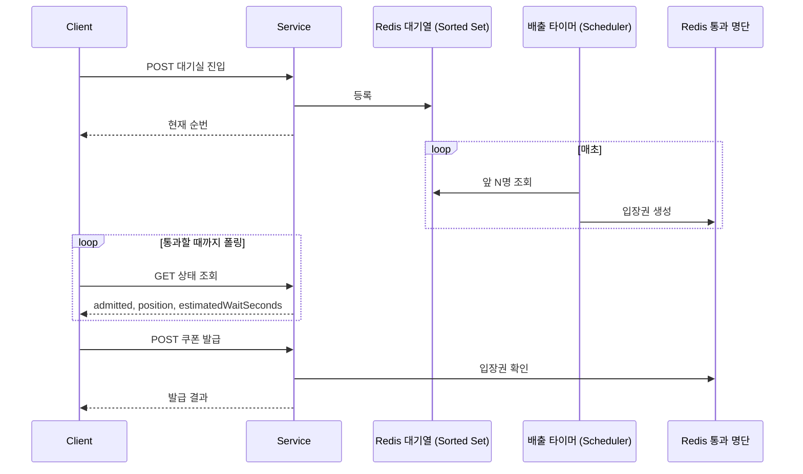
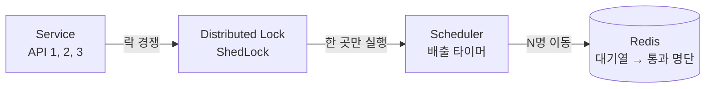
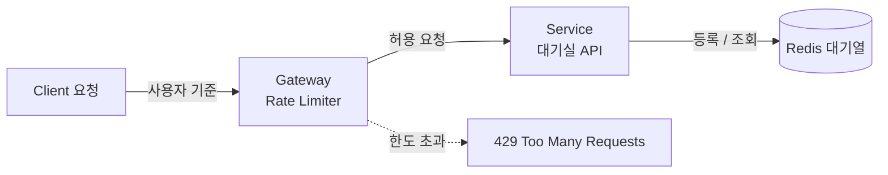
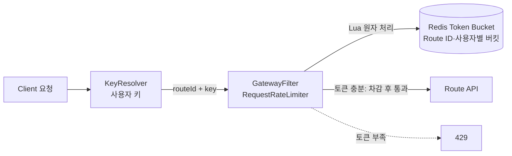

# 부하 테스트

## 사전 준비

- `brew install k6 jq`
- `docker compose up -d` 후 서비스가 8080 응답

### 브랜치 전환 시
```bash
git switch <branch>
./gradlew --stop && ./gradlew jibDockerBuild && docker compose up -d
```

## availability

들어오는 속도가 처리 속도보다 빠르면 시스템을 보호하기 위해 요청을 늦추거나 거절해야 한다. 이것을 **백프레셔(Backpressure)** 라고 한다.

| | 가상 대기실 | Rate Limiter |
|---|---|---|
| 방식 | 대기형: 처리 용량 기준으로 줄을 세우고 초당 정해진 인원만 통과 | 거절형: 특정 사용자·IP의 API 남용 차단 |
| 적용 단위 | 전역 진입 속도 | 사용자 또는 IP |
| 한도 초과 시 | FIFO 대기 | 즉시 429 |

가상 대기실 도입 조건
- **기능 요구사항:** 정상 사용자에게 순번과 예상 대기시간을 제공한다.
- **비기능 요구사항:** 발급 시스템의 전역 진입 속도를 초당 N명으로 유지한다.
- **적용 기준:** 좌석 예약에서 주로 쓰는 패턴이다. 쿠폰은 초대형 선착순 캠페인에만 선택적으로 적용한다.

### 1. 가상 대기실



1. 클라이언트가 대기실 진입 API를 호출하면 사용자는 Redis Sorted Set 대기열에 등록되고, 현재 순번을 바로 받는다.
2. 배출 타이머는 매초 대기열 앞에서 N명(예: 100명)을 꺼내 통과 명단에 입장권을 만든다.
3. 클라이언트는 상태 조회 API를 폴링해 순번과 통과 여부를 확인한다.
4. 통과하면 쿠폰 발급 API를 호출하고, 발급 API는 통과 명단의 입장권을 확인한 뒤 발급한다.

진입 API와 상태 조회 API는 같은 응답을 준다.

| 필드 | 의미 |
|---|---|
| `admitted` | 통과 명단에 입장권 키가 있으면 `true`, 없으면 `false` |
| `position` | 전역 대기열의 `ZRANK + 1`, 통과하면 0 |
| `estimatedWaitSeconds` | `position ÷ 초당 통과 인원`을 올림, 통과하면 0 (예: 4800번, 초당 100명 → 48초) |

#### 배출 타이머와 ShedLock



- 배출 타이머는 초당 N명만 통과시켜야 하므로 **반드시 한 서버만** 실행해야 한다.
- 서비스는 수평 확장으로 여러 대가 떠 있다고 가정한다. 3대가 각자 배출하면 초당 300명이 빠진다.
- 각 서버는 1초마다 같은 키로 ShedLock 획득을 시도한다. 성공한 한 대만 배출하고 나머지는 건너뛴다. 따라서 서버 수와 관계없이 전역 통과 속도가 유지된다.
- 별도 Worker 인스턴스에 배출을 맡기는 방법도 있다.

### 2. Gateway Rate Limiter

같은 사용자가 1초에 대기실 API를 1000번 호출하면, 대기열에는 순번이 하나만 남아도 1000번의 요청은 여전히 애플리케이션에 부담이 된다.
그래서 별도의 Spring Cloud Gateway 애플리케이션을 앞에 두고, 기존 Redis로 처리율 제한기를 구현해 어뷰저를 대기실 도달 전에 차단한다.



정상 사용자는 Rate Limiter를 통과해 대기실로 가고, 어뷰저는 429로 거절된다.

> Gateway도 내부 서버다. 대규모 DDoS나 대역폭을 소진시키는 공격은 Gateway만으로 부족하므로, 운영에서는 앞단에 CDN이나 방화벽을 두고 미리 제어한다.

#### RequestRateLimiter의 토큰 버킷



헤더의 사용자 키와 Route ID를 합쳐 키를 만들고, 키마다 토큰 버킷이 생긴다.

| 설정 | 의미 | 예시 |
|---|---|---|
| `replenishRate` | 초당 보충되는 토큰 수 | 5 |
| `burstCapacity` | 버킷 최대 용량 | 10 |
| `requestedTokens` | 요청 1건이 쓰는 토큰 수 | 1 |

위 설정이면 사용자 한 명은 순간적으로 최대 10건을 보낼 수 있고, 이후에는 초당 5건으로 제한된다.

> 빠르고 안정적으로 도입하려면 직접 구현하는 대신 NetFunnel 같은 관리형 대기실 서비스나 Cloudflare 기반 서비스를 검토할 수 있다.

### 실행

```bash
./scripts/load/availability/run.sh
```

### 검증

인자 없이 실행하면 현재 소스 단계(`baseline` → `single` → `gateway`)를 자동으로 고른다. 직접 고르려면 `run.sh <모드>`로 실행한다.

| 검증 | 모드 | 기대 결과 |
|---|---|---|
| 대기실 없는 발급 트래픽 급증 | `baseline` | 발급 실패 0, 요청 누락 0 |
| Redis 대기실, 서버 1대와 2대 | `single`, `scale` | 서버 수와 관계없이 약 N명/s (기본 100명/s, 허용 오차 ±30%) |
| 대기실 기능 검증 | `verify` | 순번 유지, 통과 후 발급, 미통과 403 |
| 실제 사용자 여정 | `journey` | 진입, GET 폴링, 전원 발급 |
| Gateway 요청 제한 | `gateway` | 정상 사용자 429 없음, 어뷰저 제한 |

### 실행 환경
- macOS 26.5.1, Apple M1 Pro, 32GB
- mysql:8.4 (리소스 제한 없음)
- Spring Boot 4.1.1 / JDK 25
- 앱, DB, Redis, Kafka 모두 같은 머신에서 실행

## 결과

### 1. 대기실 없는 발급 트래픽 급증 (`study5/availability-1-k6`)

조건: 5,000 req/s × 20초, 재고 1,000,000, 요청마다 다른 사용자

`RATE` 1,000 ~ 3,000 req/s에서는 대기실이 없어도 실패가 없었다.

| RATE | med | p95       | 결과 |
|---|---|-----------|---|
| 1,000 | 1.26ms | 3.19ms | 통과 |
| 2,000 | 1.57ms | 9.62ms | 통과 |
| 3,000 | 1.8ms  | 35.33ms| 통과 |
| **5,000** | **148ms** | **813ms** | **실패: 요청 누락 3,526건** |

| 지표 | 값 |
|---|---|
| 처리량 | 4,641 req/s (목표 5,000) |
| 발급 API 도달 요청 (`http_reqs`) | 96,475 |
| 발급 실패 (`issue_failures`) | 0 |
| 요청 누락 (`dropped_iterations`) | **3,526 (3.5%)** |
| 응답 시간 | avg 201.62ms / **med 148.35ms** / p90 397.27ms / **p95 812.98ms** / max 1.62s |
| 최대 동시 VU | 3,003 (상한 4,000) |
| Redis 발급자 | 96,475 |
| DB 발급 기록 | 측정 직후 31,155 → 약 90초 뒤 96,475 (워커 약 900건/s), DLT 0건 |

**분석**
- **꼬리 지연이 먼저 늘어남:** 1,000 ~ 3,000 req/s에서 중앙값은 1.26ms → 1.8ms로 거의 그대로지만, p95는 3.19ms → 9.62ms → 35.33ms로 단계마다 3 ~ 4배씩 늘었다. 대부분의 요청은 아직 빠르지만 일부 요청부터 줄을 서기 시작했다.
- **한계를 넘으면 중앙값까지 무너짐:** 5,000 req/s에서 중앙값이 148ms로, 3,000 req/s(1.8ms)보다 약 82배 늘었다. 응답이 늦어지면 VU가 오래 묶이고, 새 VU 할당이 따라가지 못해 3,526건은 보내지도 못했다. VU는 상한 4,000에 닿지 않았으므로 k6 설정 한도가 아니라 서버 지연이 원인이다.
- **서버가 거절하지는 않음:** 받은 요청은 모두 2xx로 성공했다. 거절하는 대신 느려지는 방식으로 무너진다.
- **DB 저장이 크게 밀림:** 측정 직후 DB에는 Redis 발급분의 약 32%만 있었다. 워커는 초당 약 900건을 저장하므로, 유입이 이보다 빠르면 시간차가 계속 쌓인다. 결국 다 따라잡았고 유실은 없었다(DLT 0건).
