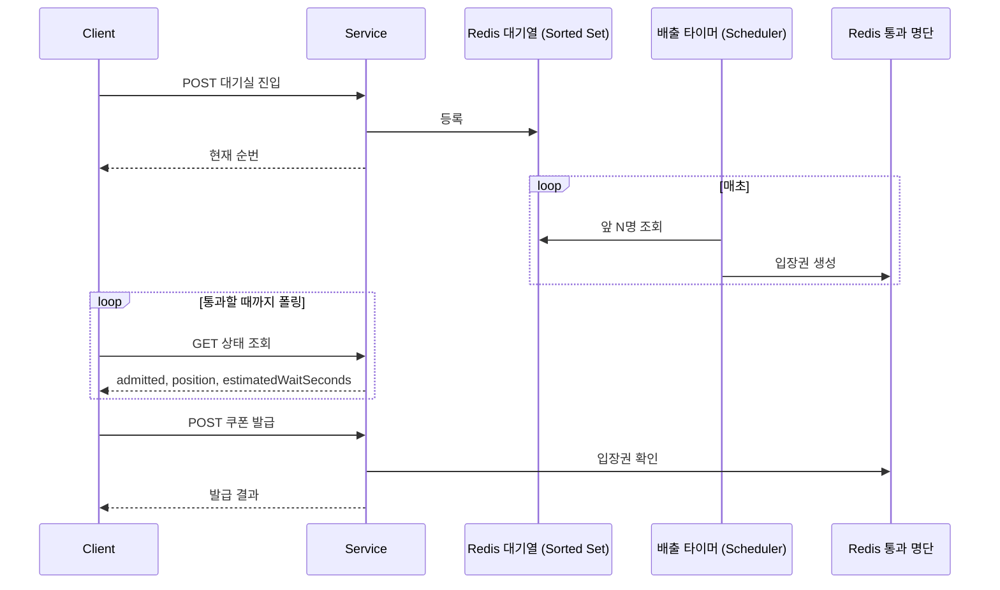
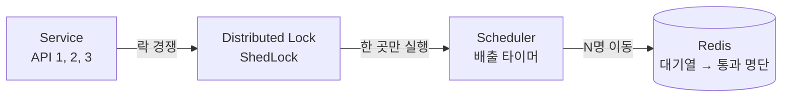
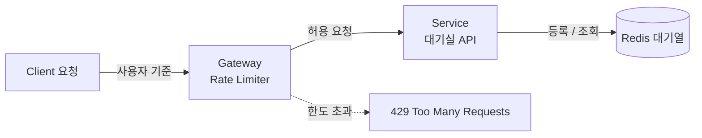
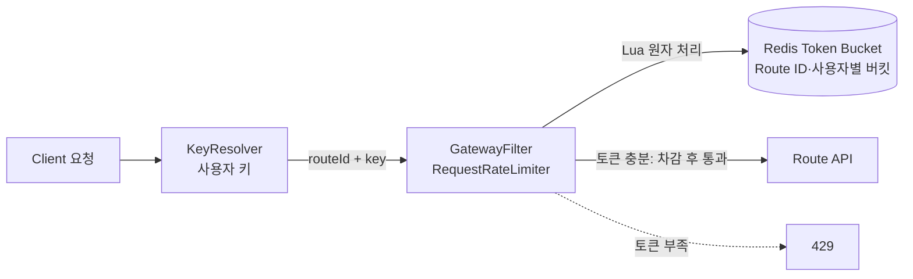

# 부하 테스트

## 사전 준비

- `brew install k6 jq`
- `docker compose up -d` 후 서비스가 8080 응답

### 브랜치 전환 시
```bash
git switch <branch>
./gradlew --stop && ./gradlew jibDockerBuild && docker compose up -d
```

## availability

들어오는 속도가 처리 속도보다 빠르면 시스템을 보호하기 위해 요청을 늦추거나 거절해야 한다. 이것을 **백프레셔(Backpressure)** 라고 한다.

| | 가상 대기실 | Rate Limiter |
|---|---|---|
| 방식 | 대기형: 처리 용량 기준으로 줄을 세우고 초당 정해진 인원만 통과 | 거절형: 특정 사용자·IP의 API 남용 차단 |
| 적용 단위 | 전역 진입 속도 | 사용자 또는 IP |
| 한도 초과 시 | FIFO 대기 | 즉시 429 |

가상 대기실 도입 조건
- **기능 요구사항:** 정상 사용자에게 순번과 예상 대기시간을 제공한다.
- **비기능 요구사항:** 발급 시스템의 전역 진입 속도를 초당 N명으로 유지한다.
- **적용 기준:** 좌석 예약에서 주로 쓰는 패턴이다. 쿠폰은 초대형 선착순 캠페인에만 선택적으로 적용한다.

### 1. 가상 대기실



1. 클라이언트가 대기실 진입 API를 호출하면 사용자는 Redis Sorted Set 대기열에 등록되고, 현재 순번을 바로 받는다.
2. 배출 타이머는 매초 대기열 앞에서 N명(예: 100명)을 꺼내 통과 명단에 입장권을 만든다.
3. 클라이언트는 상태 조회 API를 폴링해 순번과 통과 여부를 확인한다.
4. 통과하면 쿠폰 발급 API를 호출하고, 발급 API는 통과 명단의 입장권을 확인한 뒤 발급한다.

진입 API와 상태 조회 API는 같은 응답을 준다.

| 필드 | 의미 |
|---|---|
| `admitted` | 통과 명단에 입장권 키가 있으면 `true`, 없으면 `false` |
| `position` | 전역 대기열의 `ZRANK + 1`, 통과하면 0 |
| `estimatedWaitSeconds` | `position ÷ 초당 통과 인원`을 올림, 통과하면 0 (예: 4800번, 초당 100명 → 48초) |

#### 배출 타이머와 ShedLock



- 배출 타이머는 초당 N명만 통과시켜야 하므로 **반드시 한 서버만** 실행해야 한다.
- 서비스는 수평 확장으로 여러 대가 떠 있다고 가정한다. 3대가 각자 배출하면 초당 300명이 빠진다.
- 각 서버는 1초마다 같은 키로 ShedLock 획득을 시도한다. 성공한 한 대만 배출하고 나머지는 건너뛴다. 따라서 서버 수와 관계없이 전역 통과 속도가 유지된다.
- 별도 Worker 인스턴스에 배출을 맡기는 방법도 있다.

### 2. Gateway Rate Limiter

같은 사용자가 1초에 대기실 API를 1000번 호출하면, 대기열에는 순번이 하나만 남아도 1000번의 요청은 여전히 애플리케이션에 부담이 된다.
그래서 별도의 Spring Cloud Gateway 애플리케이션을 앞에 두고, 기존 Redis로 처리율 제한기를 구현해 어뷰저를 대기실 도달 전에 차단한다.



정상 사용자는 Rate Limiter를 통과해 대기실로 가고, 어뷰저는 429로 거절된다.

> Gateway도 내부 서버다. 대규모 DDoS나 대역폭을 소진시키는 공격은 Gateway만으로 부족하므로, 운영에서는 앞단에 CDN이나 방화벽을 두고 미리 제어한다.

#### RequestRateLimiter의 토큰 버킷



헤더의 사용자 키와 Route ID를 합쳐 키를 만들고, 키마다 토큰 버킷이 생긴다.

| 설정 | 의미 | 예시 |
|---|---|---|
| `replenishRate` | 초당 보충되는 토큰 수 | 5 |
| `burstCapacity` | 버킷 최대 용량 | 10 |
| `requestedTokens` | 요청 1건이 쓰는 토큰 수 | 1 |

위 설정이면 사용자 한 명은 순간적으로 최대 10건을 보낼 수 있고, 이후에는 초당 5건으로 제한된다.

> 빠르고 안정적으로 도입하려면 직접 구현하는 대신 NetFunnel 같은 관리형 대기실 서비스나 Cloudflare 기반 서비스를 검토할 수 있다.

### 실행

```bash
./scripts/load/availability/run.sh
```

### 검증

인자 없이 실행하면 현재 소스 단계(`baseline` → `single` → `gateway`)를 자동으로 고른다. 직접 고르려면 `run.sh <모드>`로 실행한다.

| 검증 | 모드 | 기대 결과 |
|---|---|---|
| 대기실 없는 발급 트래픽 급증 | `baseline` | 발급 실패 0, 요청 누락 0 |
| Redis 대기실, 서버 1대와 2대 | `single`, `scale` | 서버 수와 관계없이 약 N명/s (기본 100명/s, 허용 오차 ±30%) |
| 대기실 기능 검증 | `verify` | 순번 유지, 통과 후 발급, 미통과 403 |
| 실제 사용자 여정 | `journey` | 진입, GET 폴링, 전원 발급 |
| Gateway 요청 제한 | `gateway` | 정상 사용자 429 없음, 어뷰저 제한 |

### 실행 환경
- macOS 26.5.1, Apple M1 Pro, 32GB
- mysql:8.4 (리소스 제한 없음)
- Spring Boot 4.1.1 / JDK 25
- 앱, DB, Redis, Kafka 모두 같은 머신에서 실행

## 결과

### 1. 대기실 없는 발급 트래픽 급증 (`study5/availability-1-k6`)

조건: 5,000 req/s × 20초, 재고 1,000,000, 요청마다 다른 사용자

`RATE` 1,000 ~ 3,000 req/s에서는 대기실이 없어도 실패가 없었다.

| RATE | med | p95       | 결과 |
|---|---|-----------|---|
| 1,000 | 1.26ms | 3.19ms | 통과 |
| 2,000 | 1.57ms | 9.62ms | 통과 |
| 3,000 | 1.8ms  | 35.33ms| 통과 |
| **5,000** | **148ms** | **813ms** | **실패: 요청 누락 3,526건** |

| 지표 | 값 |
|---|---|
| 처리량 | 4,641 req/s (목표 5,000) |
| 발급 API 도달 요청 (`http_reqs`) | 96,475 |
| 발급 실패 (`issue_failures`) | 0 |
| 요청 누락 (`dropped_iterations`) | **3,526 (3.5%)** |
| 응답 시간 | avg 201.62ms / **med 148.35ms** / p90 397.27ms / **p95 812.98ms** / max 1.62s |
| 최대 동시 VU | 3,003 (상한 4,000) |
| Redis 발급자 | 96,475 |
| DB 발급 기록 | 측정 직후 31,155 → 약 90초 뒤 96,475 (워커 약 900건/s), DLT 0건 |

**분석**
- **꼬리 지연이 먼저 늘어남:** 1,000 ~ 3,000 req/s에서 중앙값은 1.26ms → 1.8ms로 거의 그대로지만, p95는 3.19ms → 9.62ms → 35.33ms로 단계마다 3 ~ 4배씩 늘었다. 대부분의 요청은 아직 빠르지만 일부 요청부터 줄을 서기 시작했다.
- **한계를 넘으면 중앙값까지 무너짐:** 5,000 req/s에서 중앙값이 148ms로, 3,000 req/s(1.8ms)보다 약 82배 늘었다. 응답이 늦어지면 VU가 오래 묶이고, 새 VU 할당이 따라가지 못해 3,526건은 보내지도 못했다. VU는 상한 4,000에 닿지 않았으므로 k6 설정 한도가 아니라 서버 지연이 원인이다.
- **서버가 거절하지는 않음:** 받은 요청은 모두 2xx로 성공했다. 거절하는 대신 느려지는 방식으로 무너진다.
- **DB 저장이 크게 밀림:** 측정 직후 DB에는 Redis 발급분의 약 32%만 있었다. 워커는 초당 약 900건을 저장하므로, 유입이 이보다 빠르면 시간차가 계속 쌓인다. 결국 다 따라잡았고 유실은 없었다(DLT 0건).

### 2. Redis 대기실, 서버 1대와 2대 (`study5/availability-2-waiting-room`)

조건: 대기실 진입 5,000 req/s × 20초, 통과 속도 100명/s, 입장권 TTL 30초, 요청마다 다른 사용자. 2대는 VU별 라운드로빈으로 나눠 보냈다.

| 지표 | `single` (서버 1대) | `scale` (서버 2대) |
|---|---|---|
| 처리량 | 4,989 req/s | 4,999 req/s |
| 진입 요청 (`http_reqs`) | 99,791 | 100,000 |
| 진입 실패 (`waiting_room_enter_failures`) | 0 | 0 |
| 요청 누락 (`dropped_iterations`) | 215 (0.2%) | 0 |
| 응답 시간 med | 754µs | 1.12ms |
| 응답 시간 p90 | 7.68ms | 7.01ms |
| 응답 시간 p95 | 182.4ms | 17.01ms |
| 응답 시간 max | 1.25s | 1.12s |
| 최대 동시 VU | 1,967 (상한 4,000) | 707 (상한 4,000) |
| Redis 입장권 | 2,100건 (약 105건/s) | 2,100건 (약 105건/s) |
| 판정 | 통과 | 통과 |

**분석**
- **서버를 늘려도 통과 속도는 그대로:** 두 경우 모두 입장권이 정확히 2,100건이다. ShedLock이 없었다면 2대에서 약 2배가 나와야 하므로, 매초 한 대만 배출한다는 뜻이다. 2,100건은 100명씩 21회 배출한 수로, 20초 측정에 k6 종료 후 집계 전 배출 1회가 더해진 것으로 보인다. 약 105건/s가 100보다 높은 이유도 이 때문이다.
- **진입 비용이 낮아짐:** 같은 5,000 req/s에서 대기실 없는 발급(`med 148ms`, `p95 813ms`, 누락 3,526건)보다 서버 1대 대기실(`med 754µs`, `p95 182.4ms`, 누락 215건)이 훨씬 가볍다. 진입은 Redis 대기열 등록만 하기 때문이다.
- **서버 1대는 한계에 가까움:** 중앙값은 1ms 미만이고 p90도 7.68ms지만 p95가 182.4ms로 뛰고 215건이 누락됐다. 일부 구간에서 지연이 몰렸고, VU도 1,967까지 늘었다. 서버 2대에서는 p95 17.01ms, 누락 0건, 최대 VU 707이었다.
- **p95 차이를 증설 효과로 단정할 수 없음:** 각 1회 측정이고 `single` 다음에 `scale`을 실행해 1번 서버가 이미 예열된 상태였다. 순서 효과를 가르려면 순서를 바꿔 반복 측정해야 한다.
- **줄은 유입 속도로 쌓임:** 약 5,000명/s가 들어오고 100명/s가 빠지므로 측정 종료 시 약 97,900명이 남는다. 100명/s로 비우면 약 16분 걸리는 계산이다. 이 측정은 진입과 배출만 검증하며, 발급 API 부하는 측정 범위가 아니다.

### 실제 사용자 여정 (`study5/availability-2-waiting-room`)

조건: 서버 1대, 사용자 200명 동시 진입, 통과 속도 100명/s, 폴링 간격 1초 + 지터 0 ~ 0.25초, 최대 대기 30초

| 지표 | 값 |
|---|---|
| 발급 성공 (`journey_issued_users`) | 200 / 200 |
| 여정 실패 (`journey_failures`) | 0 |
| 전체 소요 시간 | 2.5초 |
| 전체 요청 (`http_reqs`) | 678 (진입 200 + 폴링 278 + 발급 200) |
| HTTP 실패 (`http_req_failed`) | 0 |
| HTTP 응답 시간 | avg 13.78ms / med 3.35ms / p95 45.78ms / max 112.69ms |
| 사용자당 폴링 (`journey_polls_per_user`) | avg 1.39 / med 1 / max 2 |
| 폴링 응답 시간 (`journey_poll_latency`) | avg 1.5ms / med 1.15ms / p95 3.52ms / max 5.73ms |
| 통과까지 대기 (`journey_waiting_time`) | avg 1.6s / med 1.26s / p95 2.38s / max 2.44s |

**분석**
- **여정 전체가 동작함:** 200명 모두 진입, 폴링, 통과 후 발급까지 실패 없이 끝났다.
- **대기시간은 폴링 주기에 묶임:** 200명은 100명/s로 2회 배출되는 인원이다. 122명은 폴링 1회, 78명은 2회 만에 통과를 확인했다. 최소 대기 1.02s는 첫 폴링 간격과 같으므로, 측정값은 실제 통과 시각이 아니라 통과를 확인한 시각이다.
- **폴링 자체는 가볍고 요청 비중은 큼:** 폴링 p95는 3.52ms로 전체 HTTP p95(45.78ms)보다 훨씬 낮다. 다만 평균 1.39회만 폴링해도 전체 요청의 41%(278 / 678)를 차지한다.
- **긴 줄의 폴링 부하는 아직 검증 안 됨:** 이 측정은 대기 2초대의 200명 규모다. 결과 2처럼 약 97,900명이 줄을 서서 평균 1.125초마다 폴링하면 약 87,000 req/s가 되는 계산으로, 측정한 진입 부하 5,000 req/s의 17배가 넘는다.

### 3. Gateway 요청 제한 (`study5/availability-3-gateway-rate-limit`)

조건: 10초, 어뷰저 200 req/s(같은 사용자 1명), 정상 사용자 20 req/s(요청마다 다른 사용자), `replenishRate` 5, `burstCapacity` 10, 대기실 진입 API로 전송

| 지표 | 어뷰저 | 정상 사용자 |
|---|---|---|
| 전송 요청 | 2,001 | 201 |
| 통과 (200) | 60 | 201 |
| 제한 (429) | 1,941 (97%) | 0 |
| 그 외 실패 | 0 | 0 |

| 지표 | 값 |
|---|---|
| 전체 요청 (`http_reqs`) | 2,202 (220 req/s) |
| 요청 누락 (`dropped_iterations`) | 0 |
| 전체 응답 시간 | avg 2.19ms / med 1.66ms / p95 5.17ms / max 18.88ms |
| 성공 응답 시간 | avg 5.16ms / med 4.66ms / p95 8.89ms / max 18.88ms |
| 최대 동시 VU | 2 |

**분석**
- **어뷰저 통과량이 설정값과 일치:** 통과 60건은 `burstCapacity 10 + replenishRate 5 × 10초`로 계산한 기대값과 정확히 같다. 초당 200건을 보내도 서버에는 초당 6건만 닿았다.
- **정상 사용자는 영향 없음:** 같은 시간에 어뷰저가 제한되는 동안 정상 사용자 201건은 모두 통과했다. 버킷이 사용자별로 나뉘어 있기 때문이다.
- **`http_req_failed` 88.14%는 장애가 아님:** k6가 429를 실패로 세기 때문이다. 1,941건은 모두 의도한 제한이고, 그 외 실패는 어뷰저와 정상 사용자 모두 0건이다.
- **제한 응답이 더 빠름:** 평균으로 역산한 429 응답은 약 1.8ms로, 서비스까지 다녀오는 성공 응답 5.16ms보다 짧다. 서비스에 닿기 전에 Gateway에서 끝나기 때문이다.
- **정상 사용자가 반복 요청하는 경우는 검증 안 됨:** 이 측정의 정상 사용자는 1인당 1건만 보낸다. 폴링 평균 약 0.89 req/s는 계산상 `replenishRate` 5보다 낮지만, 진입·폴링·발급을 함께 쓰는 사용자로 측정한 값은 아니다.
- **헤더 위조는 막지 못함:** 키가 `X-User-Id` 헤더이므로 요청마다 값을 바꾸면 이 측정의 정상 사용자처럼 전부 통과한다. 운영에서는 인증된 사용자 정보를 키로 삼아야 한다.


## 스터디 정리 (기준선 → 가상 대기실 → Gateway 요청 제한)

> 처리 속도보다 빠르게 들어오는 요청은 없앨 수 없다. 그래서 어디서 기다리게 하고 어디서 거절할지를 정해야 한다.

### 1. 서버는 거절하지 않고 느려지면서 무너진다
기준선에서 받은 요청은 모두 성공했다. 그런데 5,000 req/s에서 중앙값이 1.8ms → 148ms로 늘고 3,526건은 보내지도 못했다.
에러율만 보면 정상으로 보이므로 p95와 `dropped_iterations`를 함께 봐야 한다. 처리 한계 전에 시스템이 스스로 속도를 조절하는 장치가 없으면 지연이 그대로 사용자에게 간다.

### 2. 대기실은 요청을 없애지 않고 비싼 일만 뒤로 미룬다
같은 5,000 req/s에서 진입은 Redis 대기열 등록만 하므로 중앙값이 754µs였다. 무거운 발급 처리는 초당 100명으로 제한된다.
대신 기다림이 사용자에게 넘어간다. 줄에 약 97,900명이 남으면 100명/s로 비우는 데 약 16분이 걸린다. 그래서 순번과 예상 대기시간을 알려 주는 것이 기능 요구사항이 된다.

### 3. 전역 속도는 서버 수와 분리해야 한다
서버 1대와 2대 모두 입장권이 2,100건이었다. 상태를 서버가 아니라 Redis에 두고, 배출은 ShedLock으로 한 서버만 실행한 결과다.

| 서버마다 달라지면 안 되는 것 | 공유하는 곳 |
|---|---|
| 대기 순서 | Redis Sorted Set, `TIME` 기준 score |
| 초당 통과 인원 | ShedLock으로 배출 서버를 한 대로 제한 |
| 통과 여부 | Redis 입장권 키 |

### 4. 대기실과 Rate Limiter는 막는 대상이 다르다

| | 가상 대기실 | Gateway Rate Limiter |
|---|---|---|
| 지키는 것 | 시스템 전체의 처리 용량 | 사용자 간 공정성 |
| 넘치면 | 줄을 세움 | 429로 거절 |
| 결과 | 초당 약 100명 통과 | 어뷰저 200 req/s → 6 req/s, 정상 사용자 제한 0건 |

정상 사용자가 몰리면 기다리게 하고, 한 사용자가 과하게 요청하면 거절한다. 둘 중 하나만으로는 나머지 상황을 막지 못한다.

### 5. 보호 장치도 새로운 부하와 의존성을 만든다
- **폴링:** 평균 1.39회만 폴링해도 전체 요청의 41%였다. 줄이 길면 폴링이 진입보다 큰 부하가 될 수 있다.
- **Redis:** 대기열, 입장권, ShedLock, 토큰 버킷이 모두 Redis에 있다. 보호 장치를 늘릴수록 Redis 장애의 영향도 커진다.
- **키:** 요청 제한은 키를 믿을 수 있어야 동작한다. 헤더 값을 바꾸면 사용자별 버킷이 그대로 우회된다.

### 6. 숫자는 무엇을 쟀는지 알고 읽어야 한다
- `http_req_failed` 88.14%는 장애가 아니라 의도한 429다.
- `journey_waiting_time`은 실제 통과 시각이 아니라 폴링으로 통과를 확인한 시각이다.
- 서버 2대의 p95 개선은 예열 순서 효과와 섞여 있어 증설 효과로 단정할 수 없다.

### 고려해보면 좋은 것
- **긴 줄의 폴링 측정:** 수만 명이 줄 선 상태로 폴링 부하를 측정하고, 순번이 멀수록 다음 폴링 간격을 늘리도록 서버가 내려주는 방식과 비교한다.
- **통과 인원 산정:** 100명/s는 기본값일 뿐이다. 워커 저장 속도(약 900건/s)와 DB 부하를 기준으로 한계를 찾는다.
- **미사용 입장권:** 입장권을 받고 발급하지 않은 사용자의 자리는 TTL 30초 동안 비어 있다. 입장권을 발급 뒤에도 지우지 않아 TTL 안에는 다시 호출할 수 있는 점도 함께 본다.
- **발급까지 포함한 부하:** 지금은 진입과 배출만 측정했다. 통과한 사용자가 실제로 발급하는 전체 여정을 긴 줄에서 측정한다.
- **Gateway 뒤의 정상 사용자:** 진입, 폴링, 발급을 이어서 하는 사용자가 버킷 하나로 막히지 않는지 측정한다.
- **Redis 장애:** Redis가 멈췄을 때 대기실, 입장권, 요청 제한이 어떻게 동작해야 하는지 정한다.
- **반복 측정:** `single`과 `scale`의 순서를 바꿔 3회 이상 측정해 증설 효과를 확인한다.
