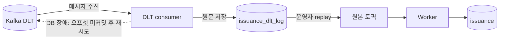
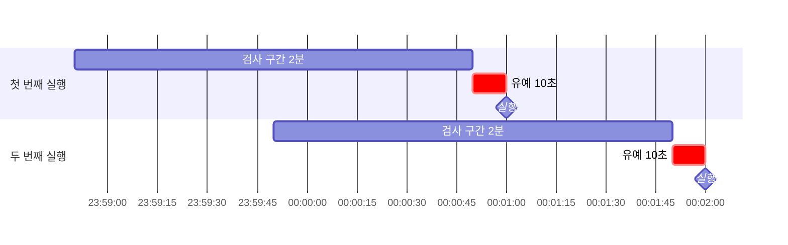

# 부하 테스트

## 사전 준비

- `brew install k6 jq`
- `docker compose up -d` 후 서비스가 8080 응답

### 브랜치 전환 시
```bash
git switch <branch>
./gradlew --stop && ./gradlew jibDockerBuild && docker compose up -d
```

## consistency

발급은 Redis에서 먼저 확정되고, DB 저장은 Kafka 워커가 나중에 한다. 그래서 정상 상황에서도 Redis와 DB 사이에 짧은 시간차가 있다.
워커가 계속 실패해 DB에 저장하지 못하면 이 시간차가 **영구적인 불일치**로 남는다.

목표
1. Redis와 DB의 불일치를 찾는다.
2. 안전하게 고칠 수 있는 불일치는 자동 보정하고, 위험한 불일치는 운영자에게 알린다.
3. 실패 원인을 기록하고, 원인을 해결한 뒤 선택한 메시지만 재처리한다.

| | DLT 재처리 | 대사 (Reconciliation) |
|---|---|---|
| 하는 일 | 실패한 발급 메시지를 다시 처리 | Redis와 DB의 현재 상태를 주기적으로 비교 |
| 대상 | 특정 실패 메시지 | 쿠폰별 DB·Redis 상태 |
| 실행 | 운영자가 원인 해결 후 선택한 메시지를 원본 토픽에 재발행 | 최근 발급은 1분마다, 놓친 쿠폰은 하루 1회 전수 검사 |

### 1. DLT 기록과 재처리



| 상태 | 의미 | 다음 처리 |
|---|---|---|
| `PENDING` | 운영자 판단을 기다리는 실패 메시지 | 원문 확인 후 replay 여부 결정 |
| `REPLAYED` | 원본 토픽 재발행 완료 | Worker 처리 결과 확인 |

- DLT 컨슈머는 DLT 메시지 원문을 판단 없이 `issuance_dlt_log`에 `PENDING`으로 기록한다.
- DB 장애로 이 기록마저 실패하면 컨슈머는 오프셋을 커밋하지 않는다. 메시지를 건너뛰지 않으므로 DB가 복구되면 미처리 오프셋부터 다시 읽어 기록한다.
- 운영자가 원인을 해결한 뒤 메시지를 골라 원본 토픽에 재발행하면 `REPLAYED`가 되고, 워커가 다시 DB에 저장한다.

두 저장소의 역할
- **Kafka DLT:** 메시지를 다시 읽을 수 있게 보관
- **`issuance_dlt_log`:** 운영자가 실패 메시지를 조회하고 원인을 확인·기록

> Kafka 클러스터 자체는 정상이라고 전제한다. 브로커·클러스터 장애까지 다루려면 복제, 다중 브로커, 별도 모니터링 같은 복구 절차가 더 필요하다.

### 2. 대사

쿠폰마다 4개의 값을 읽는다.
- DB: 총 수량(`total_quantity`), 발급 수(`issued_quantity`)
- Redis: 잔여 재고(`stock`), 사용자 수(`users`)

두 식이 모두 성립해야 정상이다. 총 수량과 잔여 재고는 같고, 발급 수를 DB에서 세는지 Redis에서 세는지만 다르다.
```
총 수량 = DB 발급 수       + Redis 잔여 재고
총 수량 = Redis 사용자 수  + Redis 잔여 재고
```

#### 자동 보정 vs 알람

| 자동 보정 | 알람 (자동 보정 X) |
|---|---|
| 전제: `총 수량 = DB 발급 수 + Redis 재고`, 재고 0 이상 | DB 발급 수와 Redis 재고 불일치 |
| `users`만 누락 → DB에 있는 사용자를 `SADD` | Redis `users` 초과 → 자동 삭제하지 않음 |
| 매진 플래그가 재고와 다름 → `DEL` 또는 `SET` | Redis 재고 키 없음 또는 재고 음수 |

DB와 Redis 재고가 맞을 때만, DB 기록을 기준으로 Redis의 `users`와 매진 플래그를 바로잡는다.

#### 검사 구간과 유예 시간



- 대사는 방금 일어난 발급을 바로 검사하지 않는다. Redis가 먼저 바뀌고 DB가 뒤따르는 정상 시간차를 장애로 오탐하지 않도록 **10초 유예**를 둔다.
- 1분마다 실행하고, 실행 시각 10초 전까지의 최근 2분 동안 발급이 있었던 쿠폰만 검사한다.
  - 00:01:00 실행 → 23:58:50 ~ 00:00:50 구간
  - 00:02:00 실행 → 23:59:50 ~ 00:01:50 구간
- 주기는 1분인데 2분을 보는 것은 안전망이다. 앞 회차와 1분씩 겹치게 봐서, 실행이 늦어지거나 한 회차가 실패해도 그 사이 발급된 쿠폰이 검사에서 빠지지 않는다. 같은 쿠폰을 두 번 검사해도 결과는 같다.
- 구간 대사에서 놓친 쿠폰은 **하루 1회 전수 검사(audit)** 로 잡는다.

### 불일치 종류

| 종류 | 상황 | 주입 스크립트 | 처리 |
|---|---|---|---|
| DB 저장 실패 | Redis는 발급 완료(재고 차감 + 명단 추가), DB에는 기록 없음 | [`force_dlt.sh`](force_dlt.sh) | DLT에 쌓인 메시지를 원인 해결 후 재처리 |
| Redis 명단 누락 | DB에는 발급 기록 있음, Redis 발급자 명단(`users`)에는 없음 | [`force_db_only.sh`](force_db_only.sh) | 대사 배치가 DB 기준으로 명단 자동 복구 |

- 명단 복구는 이미 확정된 발급을 Redis에 반영하는 것뿐이라 안전하다.
- DB 저장 실패를 Redis 재고를 되돌려 맞추면, 사용자에게 성공으로 응답한 발급이 사라진다. 그래서 자동 보정하지 않고 알람만 보낸다.

### 실행

```bash
./scripts/load/consistency/run.sh
```

`run.sh`는 현재 소스와 실행 중인 서비스를 보고 단계를 골라 실행한다. 둘이 다르면 다시 빌드하라는 안내를 띄우고 멈춘다.

### 판정 기준 [`drift_report.sh`](drift_report.sh)

| 항목 | 계산 | 의미 |
|---|---|---|
| DB 불일치 | `총 수량 - DB 발급 수 - Redis 잔여 재고` | Redis에서는 발급됐지만 DB에 없는 수 |
| 사용자 불일치 | `총 수량 - Redis 사용자 수 - Redis 잔여 재고` | 재고는 차감됐지만 Redis 명단에 없는 수 |

| DB 불일치 | 사용자 불일치 | 판정 |
|---:|---:|---|
| 0 | 0 | 정상 |
| > 0 | 0 | DB 저장 실패 → DLT 재처리 대상 |
| 0 | > 0 | Redis 명단 누락 → 대사 자동 보정 대상 |
| 그 외 | | 자동 보정하지 않고 확인 필요 |

### 실행 환경
- macOS 26.5.1, Apple M1 Pro, 32GB
- mysql:8.4 (리소스 제한 없음)
- Spring Boot 4.1.1 / JDK 25
- 앱, DB, Redis, Kafka 모두 같은 머신에서 실행

## 결과

### 1. 불일치 주입 (`study4/consistency-1-drift-injection`)

| 주입 | DB 발급 수 | Redis 잔여 재고 | Redis 사용자 수 | DB 불일치 | 사용자 불일치 | 판정 |
|---|---:|---:|---:|---:|---:|---|
| `force_dlt.sh` | 0 | 4,990 | 10 | 10 | 0 | DB 저장 실패 → DLT 재처리 대상 |
| `force_db_only.sh` | 10 | 4,990 | 0 | 0 | 10 | Redis 명단 누락 → 대사 자동 보정 대상 |

### 2. DLT 재처리 (`study4/consistency-2-dlt-replay`)

**1단계에서 바꾼 것**

| 구분 | 내용 |
|---|---|
| DLT 기록 | `IssuanceDltLogConsumer`가 DLT를 구독하고, `IssuanceDltService`가 원문(`payload`)과 실패 원인(`DLT_EXCEPTION_MESSAGE` 헤더)을 `issuance_dlt_log`에 `PENDING`으로 저장 |
| 중복 기록 방지 | `토픽:파티션:오프셋`을 `message_key`로 두고, 이미 있으면 다시 저장하지 않음 |
| 기록 실패 시 | DLT 전용 컨테이너가 5초 간격으로 무한 재시도. 오프셋을 커밋하지 않아 DB가 복구되면 그 메시지부터 다시 기록 |
| 운영자 API | `GET /admin/issuance/dlt`로 최근 100건 조회, `POST /admin/issuance/dlt/replay`로 고른 ID만 재처리 |
| 재처리 | 고른 로그를 비관적 락으로 잡고 `PENDING`인지 확인한 뒤, 받은 순서대로 원본 토픽에 재발행(전송 확인까지 대기)하고 `REPLAYED`로 변경. 한 번에 최대 100건 |
| 워커 멱등성 | 이미 DB에 발급된 사용자·쿠폰이면 저장을 건너뜀. UNIQUE 위반도 실제로 이미 발급된 경우에만 무시하고, 그 외에는 예외를 다시 던짐 |
| `reset.sh` | `issuance_dlt_log` 테이블이 있으면 함께 비움 |

| 항목 | 기대 | 결과 |
|---|---|---|
| 재처리 후 DB 발급 기록 | 1 | ✓ 1 |
| `issuance_dlt_log` 상태 | `REPLAYED` | ✓ `REPLAYED` |

**분석**
- DLT 메시지가 `issuance_dlt_log`에 `PENDING`으로 기록되고, 운영자가 고른 메시지만 원본 토픽에 재발행됐다.
- 워커가 재발행된 메시지를 처리해 Redis에만 있던 발급이 DB에 저장됐다.


### 3. 대사 (`study4/consistency-3-reconcile`)

**3단계에서 바꾼 것**

| 구분 | 내용 |
|---|---|
| 대사 대상 등록 | `issue.lua`가 발급 성공 시 `coupon:reconcile:recent` ZSET에 `ZADD` (member=쿠폰 ID, score=발급 시각 ms). 재고 차감과 같은 스크립트라 원자적으로 등록 |
| 주기 대사 | `Reconciler.scheduledRecent`가 `interval-ms`(기본 1분)마다 실행. `(cutoff - interval×2, cutoff]` 구간에 발급된 쿠폰만 검사 (`cutoff = now - 10초`) |
| 전수 검사 | `POST /admin/reconcile/run`으로 전체 쿠폰을 즉시 검사하고 결과(`autoFixed`, `driftAlerts`, `redisDbDrift`)를 응답 |
| 쿠폰별 판정 | `CouponReconciler`가 DB 식이 깨졌거나 재고가 음수면 알람만. DB 식이 맞을 때만 매진 플래그 `SET`/`DEL`, 누락 사용자 `SADD` |
| 누락 복구 조건 | DB 발급자 중 Redis `users`에 없는 사용자 수가 사용자 불일치와 정확히 같을 때만 `SADD`. 다르면 알람 |
| 예외 격리 | 한 쿠폰에서 예외가 나도 알람으로 기록하고 나머지 쿠폰은 계속 검사 |

| 항목 | 기대 | 결과 |
|---|---|---|
| 발급 시 대사 대상 등록 (`ZSCORE`) | 존재 | ✓ 존재 |
| 발급 DB 저장 | 1 | ✓ 1 |
| `force_db_only.sh` 후 발급자 명단 복구 (`SCARD users`) | 10 | ✓ 10 |
| 자동 보정 횟수 (`autoFixed`) | 1 | ✓ 1 |
| `force_dlt.sh` 후 DB 측 불일치 감지 (`redisDbDrift`) | 10 | ✓ 10 |
| Redis 재고 유지 | 4,990 | ✓ 4,990 |

**분석**
- 발급과 동시에 쿠폰이 최근 대사 대상 ZSET에 등록돼, 주기 대사가 전체 쿠폰을 훑지 않고 최근 발급된 쿠폰만 검사할 수 있다.
- Redis 명단 누락 10건은 DB 발급 기록을 기준으로 `SADD`되어 자동 복구됐다. DB 식이 맞는 상태라 DB를 정답으로 믿어도 안전하다.
- DB 저장 실패 10건은 `redisDbDrift=10`으로 감지만 하고 Redis 재고는 4,990 그대로 뒀다. 사용자에게 성공으로 응답한 발급을 되돌리지 않고, DLT 재처리로 넘긴다.


## 스터디 정리 (불일치 주입 → DLT 재처리 → 대사)

> Redis 를 먼저 확정하고 DB 를 나중에 쓰는 구조라면 Redis 와 DB 의 차이는 생길 수밖에 없다. 
> 그래서 차이를 찾아내는 장치와, 찾은 차이를 누가 어떻게 고칠지 정하는 기준이 필요하다.

### 1. 시간차와 불일치는 다르다
발급은 Redis 에서 끝나고 DB 는 Kafka 워커가 뒤따라 쓴다. 정상일 때도 Redis 와 DB 는 잠깐 다르다.
문제는 워커가 끝내 쓰지 못해 이 차이가 영구적으로 남는 경우다. 대사가 방금 일어난 발급을 10초 유예한 뒤 검사하는 것도 정상 시간차를 장애로 오탐하지 않기 위해서다.

### 2. 불일치는 두 식으로 찾는다
쿠폰마다 같은 총 수량을 두 방식으로 맞춰 본다.
```
총 수량 = DB 발급 수      + Redis 재고   → 깨지면 DB 측 불일치 (DB 저장 실패)
총 수량 = Redis 사용자 수 + Redis 재고   → 깨지면 Redis 명단 불일치
```
`force_dlt.sh` 는 첫 식, `force_db_only.sh` 는 두 번째 식만 깬다. 두 경우의 처리가 달라서 식을 나눠 둔다.

### 3. 자동 보정은 "어느 쪽이 정답인지 확실할 때만" 한다

| 불일치 | 정답 | 처리 | 결과 |
|---|---|---|---|
| Redis 명단 누락 | DB (첫 식이 맞음) | DB 사용자를 `SADD` 로 자동 복구 | 10명 복구, `autoFixed=1` |
| DB 저장 실패 | 알 수 없음 | 알람만, Redis 재고 유지 | `redisDbDrift=10`, 재고 4,990 그대로 |

- 명단 복구는 이미 확정된 발급을 Redis 에 다시 적는 것이라 안전하다.
- DB 저장 실패를 Redis 재고를 되돌려 맞추면, 사용자에게 성공으로 응답한 발급이 사라진다. 그래서 이 경우는 DLT 재처리로 DB 를 채운다.
- 누락 수가 차이와 정확히 같을 때만 복구한다. 숫자가 다르면 원인이 하나가 아니므로 사람에게 넘긴다.

### 4. 실패 메시지는 버리지 말고 사람이 고른다
DLT 메시지는 판단하지 않고 `issuance_dlt_log` 에 원문 그대로 기록한다. 기록조차 실패하면 오프셋을 커밋하지 않아 메시지를 건너뛰지 않는다.
재처리는 운영자가 원인을 해결한 뒤 고른 메시지만 원본 토픽에 다시 보낸다. 자동 재시도로는 원인(데이터 오류, 외부 장애)이 해결됐는지 알 수 없기 때문이다. 워커는 이미 저장된 발급을 건너뛰므로(멱등) 같은 메시지를 두 번 보내도 중복 발급이 생기지 않는다.

### 5. 대사는 "어디를 볼지"를 줄여야 자주 돌릴 수 있다
매 분 모든 쿠폰을 검사하면 쿠폰 수만큼 DB·Redis 를 읽는다. 발급이 없었던 쿠폰은 상태가 바뀌지 않았으니 다시 볼 필요가 없다.
`issue.lua` 가 발급할 때 `coupon:reconcile:recent` ZSET 에 쿠폰별 마지막 발급 시각을 남기고, 대사는 최근 2분 구간에 발급된 쿠폰만 꺼내 검사한다. 주기(1분)보다 2배 넓게 보는 것은 실행 지연이나 한 회차 실패에 대비한 안전망이다. 같은 쿠폰을 두 번 검사해도 결과는 같다.

| 역할 | 담당 |
|---|---|
| 볼 쿠폰 고르기 | `Reconciler` (주기: 최근 발급 쿠폰 / 수동: 전체 쿠폰) |
| 쿠폰 하나 판정·보정 | `CouponReconciler` |
| 대사 대상 기록 | `issue.lua` 의 `ZADD` (재고 차감과 같은 스크립트) |

### 고려해보면 좋은 것
- **놓친 쿠폰 전수 검사:** 앱이 2분 넘게 내려가 있으면 그 사이 발급된 쿠폰은 주기 대사 구간에서 빠진다. 지금은 `POST /admin/reconcile/run` 수동 실행뿐이므로, `auditAll` 을 하루 1회 cron 으로 돌린다.
- **매진 플래그 보정 다듬기:** 매진 플래그는 TTL(24시간) 이 지나면 사라지도록 둔 키인데, 전수 검사가 `재고 0 + 플래그 없음` 을 불일치로 보고 다시 `SET` 한다. 또 재고를 읽은 뒤 매진이 일어나면 이전에 읽은 `재고 > 0` 을 믿고 새 플래그를 `DEL` 할 수 있다. `SET` 은 `issue.lua` 에 맡기고, `DEL` 전에 재고를 다시 읽는다.
- **알람 연결:** 지금은 `log.warn` 만 남긴다. 알람 건수(`driftAlerts`)와 DB 측 불일치 수량(`redisDbDrift`)을 메트릭으로 내보내 0 이 아니면 알리도록 한다.
- **recent ZSET 정리:** 쿠폰당 한 줄이지만 지우지 않아 계속 쌓인다. 배치에서 `ZREMRANGEBYSCORE` 로 검사 구간보다 오래된 줄을 지운다.
- **발급 중인 쿠폰과 겹치는 오탐:** 전수 검사는 발급 중인 쿠폰도 보므로 DB 가 아직 따라오지 않은 차이를 불일치로 잡는다. 전수 검사도 최근 10초 안에 발급된 쿠폰은 건너뛰게 하고 오탐 수를 비교한다.
- **서버 2대 이상:** `@Scheduled` 가 서버마다 돌아 같은 쿠폰을 동시에 검사한다. 보정은 멱등이지만 알람이 중복되므로, 분산 락(ShedLock 등) 으로 한 서버만 돌게 한다.
- **Kafka 지연이 유예보다 길 때:** 부하가 몰려 워커가 10초 넘게 밀리면 정상 시간차가 알람으로 잡힌다. 컨슈머 lag 과 오탐 수를 같이 측정해 `grace-period-ms` 를 정한다.
