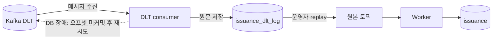
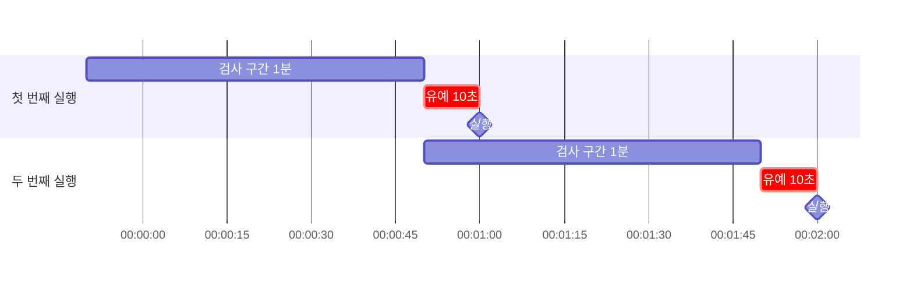

# 부하 테스트

## 사전 준비

- `brew install k6 jq`
- `docker compose up -d` 후 서비스가 8080 응답

### 브랜치 전환 시
```bash
git switch <branch>
./gradlew --stop && ./gradlew jibDockerBuild && docker compose up -d
```

## consistency

발급은 Redis에서 먼저 확정되고, DB 저장은 Kafka 워커가 나중에 한다. 그래서 정상 상황에서도 Redis와 DB 사이에 짧은 시간차가 있다.
워커가 계속 실패해 DB에 저장하지 못하면 이 시간차가 **영구적인 불일치**로 남는다.

목표
1. Redis와 DB의 불일치를 찾는다.
2. 안전하게 고칠 수 있는 불일치는 자동 보정하고, 위험한 불일치는 운영자에게 알린다.
3. 실패 원인을 기록하고, 원인을 해결한 뒤 선택한 메시지만 재처리한다.

| | DLT 재처리 | 대사 (Reconciliation) |
|---|---|---|
| 하는 일 | 실패한 발급 메시지를 다시 처리 | Redis와 DB의 현재 상태를 주기적으로 비교 |
| 대상 | 특정 실패 메시지 | 쿠폰별 DB·Redis 상태 |
| 실행 | 운영자가 원인 해결 후 선택한 메시지를 원본 토픽에 재발행 | 최근 발급은 1분마다, 놓친 쿠폰은 하루 1회 전수 검사 |

### 1. DLT 기록과 재처리



| 상태 | 의미 | 다음 처리 |
|---|---|---|
| `PENDING` | 운영자 판단을 기다리는 실패 메시지 | 원문 확인 후 replay 여부 결정 |
| `REPLAYED` | 원본 토픽 재발행 완료 | Worker 처리 결과 확인 |

- DLT 컨슈머는 DLT 메시지 원문을 판단 없이 `issuance_dlt_log`에 `PENDING`으로 기록한다.
- DB 장애로 이 기록마저 실패하면 컨슈머는 오프셋을 커밋하지 않는다. 메시지를 건너뛰지 않으므로 DB가 복구되면 미처리 오프셋부터 다시 읽어 기록한다.
- 운영자가 원인을 해결한 뒤 메시지를 골라 원본 토픽에 재발행하면 `REPLAYED`가 되고, 워커가 다시 DB에 저장한다.

두 저장소의 역할
- **Kafka DLT:** 메시지를 다시 읽을 수 있게 보관
- **`issuance_dlt_log`:** 운영자가 실패 메시지를 조회하고 원인을 확인·기록

> Kafka 클러스터 자체는 정상이라고 전제한다. 브로커·클러스터 장애까지 다루려면 복제, 다중 브로커, 별도 모니터링 같은 복구 절차가 더 필요하다.

### 2. 대사

쿠폰마다 4개의 값을 읽는다.
- DB: 총 수량(`total_quantity`), 발급 수(`issued_quantity`)
- Redis: 잔여 재고(`stock`), 사용자 수(`users`)

두 식이 모두 성립해야 정상이다. 총 수량과 잔여 재고는 같고, 발급 수를 DB에서 세는지 Redis에서 세는지만 다르다.
```
총 수량 = DB 발급 수       + Redis 잔여 재고
총 수량 = Redis 사용자 수  + Redis 잔여 재고
```

#### 자동 보정 vs 알람

| 자동 보정 | 알람 (자동 보정 X) |
|---|---|
| 전제: `총 수량 = DB 발급 수 + Redis 재고`, 재고 0 이상 | DB 발급 수와 Redis 재고 불일치 |
| `users`만 누락 → DB에 있는 사용자를 `SADD` | Redis `users` 초과 → 자동 삭제하지 않음 |
| 매진 플래그가 재고와 다름 → `DEL` 또는 `SET` | Redis 재고 키 없음 또는 재고 음수 |

DB와 Redis 재고가 맞을 때만, DB 기록을 기준으로 Redis의 `users`와 매진 플래그를 바로잡는다.

#### 검사 구간과 유예 시간



- 대사는 방금 일어난 발급을 바로 검사하지 않는다. Redis가 먼저 바뀌고 DB가 뒤따르는 정상 시간차를 장애로 오탐하지 않도록 **10초 유예**를 둔다.
- 1분마다 실행하고, 실행 시각 10초 전까지의 **최근 1분** 동안 발급이 있었던 쿠폰만 검사한다.
  - 00:01:00 실행 → 23:59:50 ~ 00:00:50 구간
  - 00:02:00 실행 → 00:00:50 ~ 00:01:50 구간
- 구간 대사에서 놓친 쿠폰은 **하루 1회 전수 검사(audit)** 로 잡는다.

### 불일치 종류

| 종류 | 상황 | 주입 스크립트 | 처리 |
|---|---|---|---|
| DB 저장 실패 | Redis는 발급 완료(재고 차감 + 명단 추가), DB에는 기록 없음 | [`force_dlt.sh`](force_dlt.sh) | DLT에 쌓인 메시지를 원인 해결 후 재처리 |
| Redis 명단 누락 | DB에는 발급 기록 있음, Redis 발급자 명단(`users`)에는 없음 | [`force_db_only.sh`](force_db_only.sh) | 대사 배치가 DB 기준으로 명단 자동 복구 |

- 명단 복구는 이미 확정된 발급을 Redis에 반영하는 것뿐이라 안전하다.
- DB 저장 실패를 Redis 재고를 되돌려 맞추면, 사용자에게 성공으로 응답한 발급이 사라진다. 그래서 자동 보정하지 않고 알람만 보낸다.

### 실행

```bash
./scripts/load/consistency/run.sh
```

`run.sh`는 현재 소스와 실행 중인 서비스를 보고 단계를 골라 실행한다. 둘이 다르면 다시 빌드하라는 안내를 띄우고 멈춘다.

### 판정 기준 [`drift_report.sh`](drift_report.sh)

| 항목 | 계산 | 의미 |
|---|---|---|
| DB 불일치 | `총 수량 - DB 발급 수 - Redis 잔여 재고` | Redis에서는 발급됐지만 DB에 없는 수 |
| 사용자 불일치 | `총 수량 - Redis 사용자 수 - Redis 잔여 재고` | 재고는 차감됐지만 Redis 명단에 없는 수 |

| DB 불일치 | 사용자 불일치 | 판정 |
|---:|---:|---|
| 0 | 0 | 정상 |
| > 0 | 0 | DB 저장 실패 → DLT 재처리 대상 |
| 0 | > 0 | Redis 명단 누락 → 대사 자동 보정 대상 |
| 그 외 | | 자동 보정하지 않고 확인 필요 |

### 실행 환경
- macOS 26.5.1, Apple M1 Pro, 32GB
- mysql:8.4 (리소스 제한 없음)
- Spring Boot 4.1.1 / JDK 25
- 앱, DB, Redis, Kafka 모두 같은 머신에서 실행

## 결과

### 1. 불일치 주입 (`study4/consistency-1-drift-injection`)

| 주입 | DB 발급 수 | Redis 잔여 재고 | Redis 사용자 수 | DB 불일치 | 사용자 불일치 | 판정 |
|---|---:|---:|---:|---:|---:|---|
| `force_dlt.sh` | 0 | 4,990 | 10 | 10 | 0 | DB 저장 실패 → DLT 재처리 대상 |
| `force_db_only.sh` | 10 | 4,990 | 0 | 0 | 10 | Redis 명단 누락 → 대사 자동 보정 대상 |

