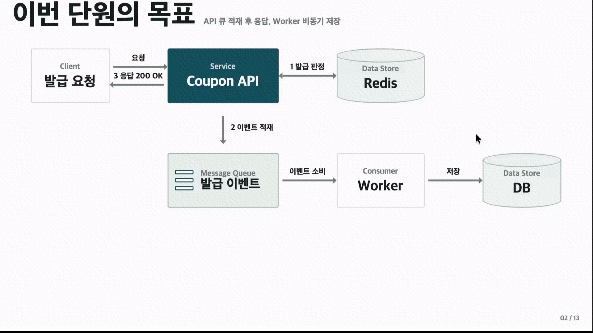
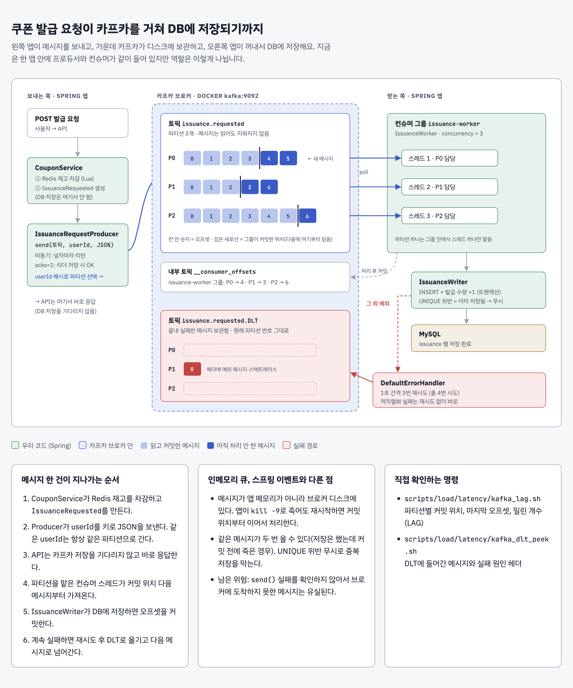

# 부하 테스트

### 브랜치 전환 시
```bash
git switch <branch>
./gradlew --stop && ./gradlew jibDockerBuild && docker compose up -d
```

## latency

redis에서 발급 판정을 마치고 쿠폰 발급 이벤트를 적재한다. 그리고 200 응답을 반환한다.
Worker가 항상 별도로 존재하고 이벤트가 들어오면 그 메시지를 소비해서 쿠폰 발급 DB 작업을 실행한다.

> Worker가 책임
> 트랜잭션: Issuance 저장과 Coupon 증가
> 원자 증가: 여러 Worker가 lost update방지. Worker를 여러개 둘 경우 그 Worker가 그 메세지를 동시에 소비하게 되면서 경쟁 상태에 놓이게 될 수 있다.
> 멱등 처리: UNIQUE 중복은 성공으로 흡수

### 동기 DB의 한계
DB 부하가 커지면 요청 스레드가 DB 작업을 기다려 사용자 응답이 느려질 수 있다.
큐를 분리하면 발급 이벤트는 큐에 넣고 바로 응답하고 Worker가 뒤에서 쿠폰 db 저장을 처리한다.

```bash
./scripts/load/latency/run.sh
```

### 실행 환경
- macOS 26.5.1, Apple M1 Pro, 32GB
- mysql:8.4 (리소스 제한 없음)
- Spring Boot 4.1.1 / JDK 25
- k6, 앱, DB 모두 같은 머신에서 실행

### 고정한 데이터·표본·명령
- 쿠폰: `total_quantity = 5000`, 매 회차 전 `coupon`, `issuance` 테이블과 Redis 리셋
- 사용자: `X-User-Id` 를 1~20,000 중 랜덤 (같은 사용자 중복 요청 발생)
- 대상 API: `POST /api/coupons/{couponId}/issue`
- k6 시나리오: [`issue_burst.js`](issue_burst.js) — `constant-arrival-rate` `RATE` req/s × 30s (VU 2,000~`MAX_VUS`)
  - 1차: `RATE=5000` (폐기)
  - 2차: `RATE=3000`, `MAX_VUS=15000` (폐기)
  - 3차: `RATE=3000`, `MAX_VUS=5000` 으로 고정 (기준선)
- 실행: 워밍업 1회 후 본 측정 1회, 본 측정 값만 기록
- 기대 결과: `issue_latency` p99 < 500ms, `status_other = 0`, 정합성 유지


### 판정 기준 [`verify_burst.sh`](verify_burst.sh)
Worker 가 큐를 다 비울 때까지(발급 수가 3초간 변하지 않을 때까지) 기다린 뒤 확인한다.

| 항목 | 의미 | 통과 조건 |
|---|---|---|
| `issue_latency` | 사용자 응답 시간 | `p(99) < 500ms` |
| `conn_reset` | 서버가 연결을 끊은 요청 수 (레이턴시에서 제외) | `0` |
| `over_issuance` | 재고보다 많이 발급됐는가 | `issuance_rows <= total_quantity` |
| `count_match` | 카운터 필드가 실제 발급 수와 맞는가 | `issued_quantity = issuance_rows` |


## 결과

### 1. 동기 (기준선, `study2/latency-1-k6`)

#### 1-1. 1차: `RATE=5000` (폐기)

| issued_quantity | total_quantity | issuance_rows | over_issuance | count_match |
|---:|---:|---:|:---:|:---:|
| 4,996 | 5,000 | 4,996 | OK | OK |

| 지표 | 값 |
|---|---|
| 처리량 | 3,560 req/s (목표 5,000) |
| dropped_iterations | 43,178 |
| issue_latency (전체) | avg 814ms / med 372ms / p95 4.66s / **p99 7.24s** / max 8.04s |
| 성공 요청 latency | avg 4.76s / med 5.02s / p95 7.56s / max 7.87s |
| status_2xx | 4,996 |
| status_409 (매진·중복) | 101,823 |
| status_other | 4 |

**분석**
- **임계 실패:** p99 7.24s 로 목표 500ms 의 14배
- **목표 부하에 도달하지 못함:** VU 5,000 개가 응답 대기에 묶여 `Insufficient VUs`, 43,178건은 보내지도 못했따.
- **발급 성공자가 가장 오래 기다림:** 성공 요청 중간값 5.02s. 매진 응답은 빠르지만 실제로 쿠폰을 받는 사용자는 DB 저장(중복 확인, UPDATE, INSERT, 커밋)이 끝날 때까지 기다린다.
- **전체 중간값이 낮은 이유:** 요청의 95%가 매진 응답이라 빠르게 끝나 평균을 끌어내린다. 응답성은 성공 요청과 p99 로 봐야 한다.
- **과소 발급 4건:** `status_other` 4건과 일치. 같은 사용자 동시 요청이 UNIQUE 제약에 걸려 500, Redis 재고는 차감된 채 남음 (concurrency 3번과 같은 원인)

**1차의 문제점**
- **브랜치마다 받는 부하가 달라짐:** 동기는 목표의 71%(3,560 req/s)만 받았다. 비동기가 5,000 을 다 받으면 서로 다른 부하에서 레이턴시를 비교하게 된다.
- **p99 가 실제 지연보다 낮게 나옴:** VU 5,000 개가 응답 대기에 묶여 43,178건을 보내지 못했다. 보내지 못한 요청은 레이턴시에 기록되지 않아 실제보다 좋게 보인다.
- **k6 가 앱의 CPU 를 빼앗음:** k6, 앱, DB 가 한 머신에서 돌아 VU 5,000 개를 돌리는 k6 부하가 앱 응답 시간에 섞인다.
- **결론:** 동기 방식이 `dropped_iterations` 없이 버티는 rate 로 낮춰 모든 브랜치에 같은 부하를 준다. → `RATE` 환경변수로 변경

#### 1-2. 2차: `RATE=3000`, `MAX_VUS=15000` (폐기)

**1차에서 바꾼 것:** rate 5,000 → 3,000, VU 최대 5,000 → 15,000, 연결 끊김(`conn_reset`)을 레이턴시에서 제외

| issued_quantity | total_quantity | issuance_rows | over_issuance | count_match |
|---:|---:|---:|:---:|:---:|
| 4,998 | 5,000 | 4,998 | OK | OK |

| 지표 | 값 |
|---|---|
| 처리량 | 1,058 req/s (목표 3,000) |
| dropped_iterations | 26,135 |
| conn_reset | 5,185 |
| issue_latency (전체) | avg 2.17s / med 351ms / p95 10.18s / **p99 10.63s** / max 11.33s |
| 성공 요청 latency | avg 5.74s / med 5.92s / p95 10.36s / max 11s |
| status_2xx | 4,998 |
| status_409 (매진·중복) | 53,578 |
| status_other | 2 |
| 소요 시간 | 1m00s (30s 시나리오 + graceful stop 30s, 102건 중단) |

**2차의 문제점**
- **VU 를 늘려도 드롭이 남음:** 최대 15,000 을 허용했지만 실제로는 8,303 개까지만 만들어졌고 26,135건은 보내지 못했다.
- **서버가 연결을 끊음:** Tomcat 기본 한도(`max-connections` 8,192 + `accept-count` 100)를 넘는 연결 5,185건이 `cnnection reset by peer`
- **오히려 나빠짐:** 보낸 요청 수 `73,028 → 63,763`, `p99 6.19s → 10.63s`. k6 가 VU 8,000 개를 돌리느라 같은 머신의 앱이 CPU 를 덜 받는다.
- **결론:** 동기 방식은 VU 를 늘려도 다 받지 못한다. `MAX_VUS=5000` 으로 되돌려 모든 브랜치에 같은 설정을 주고, `dropped_iterations`, `conn_reset` 도 결과 지표로 함께 비교한다.

#### 1-3. 3차: `RATE=3000`, `MAX_VUS=5000` (기준선)

**2차에서 바꾼 것:** VU 최대 15,000 → 5,000 으로 되돌림.

| issued_quantity | total_quantity | issuance_rows | over_issuance | count_match |
|---:|---:|---:|:---:|:---:|
| 4,997 | 5,000 | 4,997 | OK | OK |

| 지표 | 값 |
|---|---|
| 처리량 | 2,458 req/s (목표 3,000) |
| dropped_iterations | 16,255 |
| conn_reset | 0 |
| issue_latency (전체) | avg 577ms / med 1.59ms / p95 4.72s / **p99 5.93s** / max 6.33s |
| 성공 요청 latency | avg 3.6s / med 3.94s / p95 5.9s / max 6.2s |
| status_2xx | 4,997 |
| status_409 (매진·중복) | 68,746 |
| status_other | 3 |

**분석**
- **임계 실패:** p99 5.93s 로 목표 500ms 의 약 12배
- **발급 성공자가 가장 오래 기다림:** 성공 요청 중간값 3.94s. 매진 응답 중간값은 1.59ms 로, 쿠폰을 받는 요청만 DB 저장을 기다린다.
- **폭증 구간에 VU 가 묶임:** 발급 요청이 4초씩 VU 를 잡아 5,000 개가 모두 소진, 16,255건(18%)은 보내지 못했다. 재고가 매진된 뒤에는 응답이 빨라져 VU 가 다시 남는다.
- **연결 끊김 없음:** Tomcat 연결 한도(8,192) 안이라 `conn_reset = 0`
- **과소 발급 3건:** `status_other` 3건과 일치
- **비동기 브랜치에서 볼 것:** 성공 요청 latency, p99, `dropped_iterations` 가 줄어드는가


### 2. 인메모리(`study2/latency-2-inmemory-queue`)

**설정:** 3차와 동일 (`RATE=3000`, `MAX_VUS=5000`)

| issued_quantity | total_quantity | issuance_rows | over_issuance | count_match |
|---:|---:|---:|:---:|:---:|
| 5,000 | 5,000 | 5,000 | OK | OK |

| 지표 | 동기 (3차) | 인메모리 |
|---|---|---|
| 처리량 | 2,458 req/s | 3,000 req/s (목표 3,000) |
| dropped_iterations | 16,255 | 0 |
| conn_reset | 0 | 0 |
| 최대 동시 VU | 5,000 (소진) | 40 |
| issue_latency (전체) | avg 577ms / med 1.59ms / p95 4.72s / **p99 5.93s** / max 6.33s | avg 2.58ms / med 1.47ms / p95 6.27ms / **p99 29.01ms** / max 126.79ms |
| 성공 요청 latency | avg 3.6s / med 3.94s / p95 5.9s / max 6.2s | avg 7.03ms / med 1.98ms / p95 28.14ms / max 81.97ms |
| status_2xx | 4,997 | 5,000 |
| status_409 (매진·중복) | 68,746 | 85,001 |
| status_other | 3 | 0 |

**분석**
- **임계 통과:** p99 29.01ms 로 목표 500ms 안. 동기 5.93s 대비 약 200배 감소
- **성공 요청도 빨라짐:** 성공 요청 중간값 `3.94s → 1.98ms`. 요청 스레드는 Redis 판정 후 큐에 넣고 바로 응답하고, DB 저장은 Worker 가 뒤에서 한다.
- **목표 부하를 다 받음:** 응답이 빨라 VU 가 최대 40개만 쓰였고 `dropped_iterations = 0`. 모든 요청이 레이턴시에 기록돼 같은 부하에서 비교할 수 있다.
- **과소 발급 없음:** Lua 에서 중복 사용자를 먼저 거르므로(`SISMEMBER`) 같은 사용자 동시 요청이 UNIQUE 에 걸려 500 이 나던 경로가 사라짐. `status_other = 0`, 5,000 / 5,000 발급
- **정합성 유지:** Worker 드레인 후 `issuance_rows = issued_quantity = 5,000`
- **남은 문제 (내구성):** 응답 200 은 "큐에 넣음"이지 "DB 저장 완료"가 아니다. 드레인 전에 JVM 이 죽으면 Redis 재고는 차감됐는데 DB 에는 없는 발급이 생긴다.

### 3. 스프링 이벤트(`study2/latency-3-spring-event`)

**설정:** 3차와 동일 (`RATE=3000`, `MAX_VUS=5000`)

**인메모리에서 바꾼 것:** 직접 만든 큐(`InMemoryIssuanceQueue`)와 Worker 루프를 지우고 `ApplicationEventPublisher.publishEvent` + `@Async @EventListener` 로 교체. Executor 는 스레드 1개(`core = max = 1`), 큐 10,000 으로 인메모리와 같은 구조다.

| issued_quantity | total_quantity | issuance_rows | over_issuance | count_match |
|---:|---:|---:|:---:|:---:|
| 5,000 | 5,000 | 5,000 | OK | OK |

| 지표 | 동기 (3차) | 인메모리 | 스프링 이벤트 |
|---|---|---|---|
| 처리량 | 2,458 req/s | 3,000 req/s | 3,000 req/s |
| dropped_iterations | 16,255 | 0 | 0 |
| conn_reset | 0 | 0 | 0 |
| 최대 동시 VU | 5,000 (소진) | 40 | 157 |
| issue_latency (전체) | avg 577ms / med 1.59ms / p95 4.72s / **p99 5.93s** / max 6.33s | avg 2.58ms / med 1.47ms / p95 6.27ms / **p99 29.01ms** / max 126.79ms | avg 6.21ms / med 1.45ms / p95 17.61ms / **p99 124.08ms** / max 602.76ms |
| 성공 요청 latency | avg 3.6s / med 3.94s / p95 5.9s / max 6.2s | avg 7.03ms / med 1.98ms / p95 28.14ms / max 81.97ms | avg 54.57ms / med 6.53ms / p95 221.67ms / max 602.76ms |
| status_2xx | 4,997 | 5,000 | 5,000 |
| status_409 (매진·중복) | 68,746 | 85,001 | 85,001 |
| status_other | 3 | 0 | 0 |

**분석**
- **임계 통과:** p99 124.08ms 로 목표 500ms 안. `dropped_iterations = 0`, 5,000 / 5,000 발급, 정합성 유지
- **스프링 이벤트는 인메모리 큐를 스프링이 대신 관리하는 것:** `@Async` Executor 도 스레드 1개 + 메모리 큐(10,000)라 구조가 같다. 직접 만든 큐, Worker 루프, 스레드 종료 처리가 사라지고 핸들러는 한 줄만 남는다.
- **성능 차이는 확인되지 않음:** 중간값은 같고(1.45ms) p99 는 124ms 로 더 높게 나왔지만, 구조가 같아 1회 측정의 편차일 수 있다. 원인은 확인하지 않았다.
- **큐 포화 처리는 직접 챙겨야 함:** 큐가 차면 Executor 가 `TaskRejectedException` 을 던지는데 처리하는 핸들러가 없어 503 이 아닌 일반 오류가 된다.
- **내구성은 그대로:** 이벤트도 JVM 메모리에 있어 프로세스가 강제 종료되면(`kill -9`, OOM) 발급이 유실된다. 종료 시 30초 대기는 정상 종료에서만 동작한다. 발급 방식을 바꾸는 게 아니라 큐를 JVM 밖으로 빼야 해결된다.

### 4. 카프카(`study2/latency-4-kafka`)



**설정:** 3차와 동일 (`RATE=3000`, `MAX_VUS=5000`)

**스프링 이벤트에서 바꾼 것** 
- `publishEvent` 를 `IssuanceRequestProducer.publish` (KafkaTemplate `send`, 키 = userId) 로 교체. 
- 토픽 `issuance.requested` 파티션 3개, `@KafkaListener` `concurrency = 3` 으로 컨슈머 스레드 3개가 파티션을 하나씩 맡는다. 
- 3번 재시도(1초 간격) 후에도 실패하면 `issuance.requested.DLT` 로 보낸다. 
- 브로커는 같은 머신의 Docker 컨테이너 1대(`apache/kafka:3.8.0`, KRaft)다.

| issued_quantity | total_quantity | issuance_rows | over_issuance | count_match |
|---:|---:|---:|:---:|:---:|
| 5,000 | 5,000 | 5,000 | OK | OK |

| 지표 | 동기 (3차) | 인메모리 | 스프링 이벤트 | 카프카 |
|---|---:|---:|---:|---:|
| **p99 (전체)** | 5.93s | 29.01ms | 124.08ms | **294.71ms** |
| 중간값 (전체) | 1.59ms | 1.47ms | 1.45ms | 1.86ms |
| 성공 요청 중간값 | 3.94s | 1.98ms | 6.53ms | 8.17ms |
| 성공 요청 p95 | 5.9s | 28.14ms | 221.67ms | 107.88ms |
| max (전체 / 성공) | 6.33s / 6.2s | 127ms / 82ms | 603ms / 603ms | 782ms / 239ms |
| dropped_iterations | 16,255 | 0 | 0 | 0 |
| 최대 동시 VU | 5,000 (소진) | 40 | 157 | 866 |
| status_other | 3 | 0 | 0 | 0 |

**분석**
- **임계 통과:** p99 294.71ms 로 목표 500ms 안. `dropped_iterations = 0`, 5,000 / 5,000 발급, 정합성 유지
- **꼬리 지연은 인메모리·스프링 이벤트보다 큼:** 중간값은 1.86ms 로 비슷하지만 p95 95.75ms, p99 294.71ms 로 늘었고 최대 동시 VU 도 866 개로 많아졌다. 전체 max(782ms)가 성공 요청 max(239ms)보다 커서 매진 응답까지 함께 느려진 구간이 있다. 같은 머신에서 k6, 앱, MySQL 에 브로커 컨테이너와 컨슈머 스레드 3개가 더해진 영향으로 추정하지만 원인은 확인하지 않았다.
- **응답 200:** `send()` 는 비동기라 메시지를 프로듀서 버퍼에 넣고 바로 리턴한다. 응답 200 은 "DB 저장 완료"도 "브로커 저장 완료"도 아니다.
- **내구성:** 브로커에 도착한 메시지는 앱 JVM 밖(브로커 디스크)에 있어, 앱이 강제 종료돼도 재시작 후 커밋 위치부터 다시 처리한다.
- **남은 유실 경로:** `send()` 결과(`CompletableFuture`)를 확인하지 않아 브로커에 도착하지 못한 메시지는 Redis 재고만 차감된 채 사라진다. `acks=1` 이라 복제 전에 리더가 죽어도 유실될 수 있지만, 지금은 브로커 1대라 해당 없다.
- **중복 소비는 멱등으로 흡수:** 저장 후 오프셋 커밋 전에 죽으면 같은 메시지가 다시 온다. `IssuanceWriter` 가 UNIQUE 위반을 무시해 중복 저장되지 않는다.


## 왜 카프카를 쓰나

인메모리 큐와 스프링 이벤트는 발급 요청을 앱 JVM 메모리에 들고 있다. 카프카는 큐를 JVM 밖(브로커 디스크)으로 뺀다.

| 상황 | 인메모리 / 스프링 이벤트 | 카프카 |
|---|---|---|
| 앱 강제 종료 | 큐에 남은 발급 유실, Redis 재고만 차감된 채 남음 | 브로커에 남아 재시작 후 커밋 위치부터 이어서 처리 |
| 앱 서버 2대 이상 | 서버마다 큐가 따로, 각자 자기 큐만 처리 | 한 토픽을 여러 서버의 컨슈머가 파티션 단위로 나눠 처리 |
| 저장이 계속 실패 | 로그만 남고 끝 | 재시도 후 DLT 에 보관, 나중에 확인·재처리 |
| 같은 이벤트를 다른 용도로도 사용 (알림, 통계) | 코드 추가 필요 | 컨슈머 그룹을 하나 더 만들면 처음부터 따로 읽음 |
| 트래픽 폭증 | 큐(10,000)가 차면 거절 | 디스크에 쌓아두고 컨슈머가 자기 속도로 처리 |

인메모리·스프링 이벤트에서 남은 문제가 내구성이었고, 응답 속도를 유지하면서 이를 해결하려고 카프카를 쓴다.

### 왜 인메모리가 가장 빠르고 점점 느려지나

인메모리가 가장 빠른 이유는 하는 일과 보장하는 게 가장 적기 때문이다. 카프카는 일을 더 하는 대신 내구성을 얻는다.

- **인메모리 vs 스프링 이벤트:** 둘 다 스레드 1개 + 메모리 큐로 하는 일이 같다. 중간값도 1.47ms / 1.45ms 로 같고 p99 만 다르므로 1회 측정의 편차일 가능성이 크다.
- **카프카는 실제로 일이 더 많다.**
  - 요청 스레드: 인메모리는 `queue.offer()` 로 참조 하나를 넣는다. 카프카는 JSON 직렬화, 키 해시로 파티션 선택, 프로듀서 버퍼 복사까지 한다. 네트워크 전송은 백그라운드라 기다리지 않는다.
  - 같은 머신의 추가 부하: k6, 앱, MySQL 에 브로커 컨테이너(디스크 쓰기, 네트워크 처리)와 컨슈머 스레드 3개(인메모리는 Worker 1개)가 더해져 MySQL 동시 INSERT 도 늘었다.

**정리**
- 측정한 것은 사용자 응답 시간뿐이다. 응답 속도는 인메모리가 가장 좋고, 카프카는 내구성을 얻는 대가를 낸다. 그래도 p99 295ms 로 목표 500ms 안이고 동기(5.93s) 대비 차이는 작다.
- 카프카의 장점은 드레인 중 `kill -9` 후 재시작했을 때 발급 5,000건이 모두 남는지로 확인해야 숫자로 드러난다. (미측정)


## 스터디 정리 (동기 → 인메모리 → 스프링 이벤트 → 카프카)

> 응답을 빠르게 하려고 작업을 뒤로 미루면, 미룬 작업을 잃지 않게 하는 책임이 새로 생긴다.

### 1. 응답 속도는 "무엇을 기다리느냐"로 정해진다
동기 방식이 느렸던 건 DB 자체보다 요청 스레드가 DB 저장을 기다렸기 때문이다. 발급 판정(Redis)과 저장(DB)을 분리해 저장을 뒤로 미루자 같은 DB, 같은 쿼리로 성공 요청 중간값이 `3.94s → 1.98ms` 가 됐다.

### 2. 비동기에서는 응답 200 의 의미가 바뀐다
- 동기: 200 = DB 저장 완료
- 비동기: 200 = 저장하겠다고 접수함

접수와 저장 사이에서 생기는 문제를 직접 챙겨야 한다.

| 문제 | 대응 |
|---|---|
| 그 사이 앱이 죽으면? | 내구성 (큐를 JVM 밖으로) |
| 같은 메시지가 두 번 오면? | 멱등성 (UNIQUE 위반 무시) |
| 저장이 계속 실패하면? | 재시도 + DLT |
| 큐가 꽉 차면? | 포화 처리 |

### 3. 큐가 어디에 있느냐가 내구성을 결정한다
인메모리와 스프링 이벤트는 코드 모양은 달라도 둘 다 JVM 메모리 안의 큐라 한계가 같다. 스프링 이벤트로 바꿔 코드는 깔끔해졌지만 `kill -9` 에 유실되는 건 그대로였다. 큐를 JVM 밖(카프카 브로커)으로 빼야 해결된다.

### 4. 속도와 보장은 맞바꾸는 관계다
인메모리가 가장 빠른 건 가장 적게 일하고 가장 적게 보장하기 때문이다. 카프카는 p99 가 `29ms → 295ms` 로 늘었지만 내구성, 수평 확장, 재처리를 얻었고 목표(500ms) 안이다. 가장 빠른 것이 아니라 요구사항을 만족하는 것 중 필요한 보장을 주는 것을 고른다.

### 5. 측정 방법이 결과를 바꾼다
폐기한 1차·2차 측정에서 배운 것:
- 보내지 못한 요청(`dropped_iterations`)은 레이턴시에 잡히지 않아 결과가 실제보다 좋아 보인다.
- k6, 앱, DB 가 한 머신에 있으면 부하 도구가 앱의 CPU 를 빼앗는다.
- 매진 응답이 95% 라 전체 중간값은 의미가 없다. 성공 요청과 p99 를 봐야 한다.
- 1회 측정의 작은 차이(인메모리 vs 스프링 이벤트)는 편차일 수 있다.

### 남은 것
- **카프카 내구성 검증:** 드레인 중 `kill -9` 후 재시작했을 때 인메모리는 유실되고 카프카는 5,000건이 모두 남는지 비교한다. (미측정)
- **`send()` 실패 처리:** 결과를 확인하지 않아 브로커에 도착하지 못한 메시지는 여전히 유실될 수 있다.
